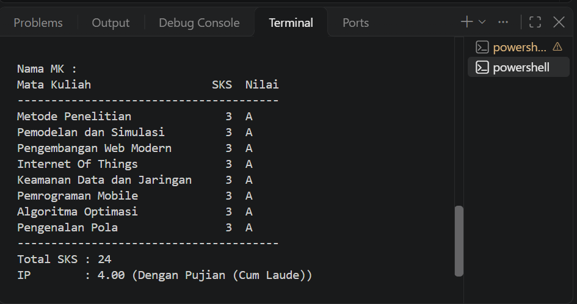
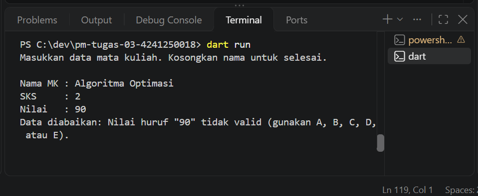

# Tugas Rutin 3 - Kalkulator IP Semester (Console)

## Identitas
- Nama: Callysa Elistia
- NIM: 4241250018
- Kelas: PSIK 24C
- Mata Kuliah: Pemrograman Mobile (3KOM40215)

## Tangkapan Layar Sesi

*(Tangkapan layar memperlihatkan pengujian input data mata kuliah termasuk input tidak valid yang ditangani program serta hasil akhir perhitungan IP/KHS).*

## Penjelasan Higher-Order Function dan Error Handling
Pada program ini, **higher-order function** dipakai pada beberapa fungsi utama. Pertama, fungsi `hitungIp` dan `cetakKhs` menggunakan method `.fold()` dengan fungsi anonim akumulator untuk menjumlahkan total SKS dan menghitung akumulasi bobot dikali SKS[cite: 18]. Kedua, fungsi `cetakKhs` memakai method `.sort()` dengan fungsi pembanding `(a, b) => bobot(b.nilai).compareTo(bobot(a.nilai))` untuk mengurutkan mata kuliah dari nilai tertinggi[cite: 18]. Ketiga, fungsi `cetakKhs` menggunakan `.where()` dan `.map()` untuk menyaring mata kuliah dengan bobot di bawah `2.0` sebagai daftar yang perlu diperbaiki[cite: 18].

Untuk **error handling**, validasi input dipisahkan ke fungsi `validasiSks` dan `validasiNilai` yang melempar (`throw`) `FormatException` jika input SKS bukan angka `1-6` atau nilai huruf bukan `A-E`[cite: 18]. Exception tersebut ditangkap di blok `try-on FormatException-catch` pada fungsi `main()`, sehingga entri yang salah diabaikan dan program tetap berjalan normal[cite: 18].

## Pernyataan Penggunaan AI
AI digunakan sebagai asisten diskusi untuk menyusun struktur fungsi, memverifikasi kesesuaian implementasi *higher-order function* dan *error handling* dengan modul, serta merapikan dokumentasi.